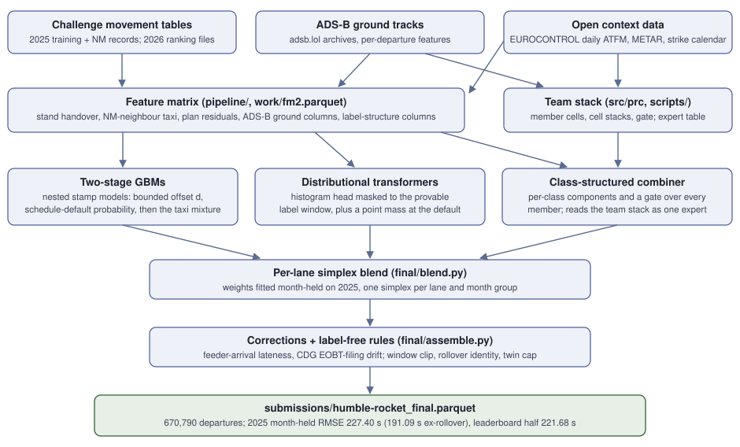
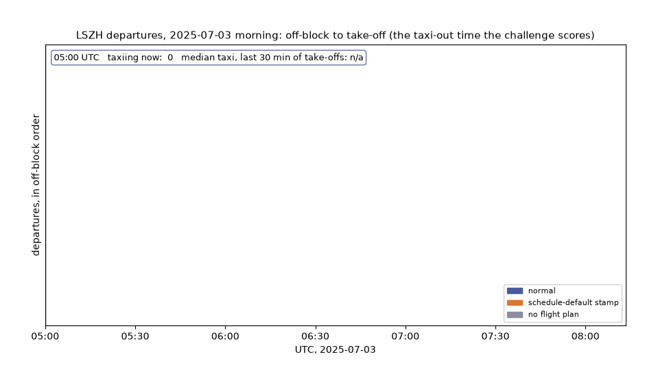

# Taxi-out time prediction at ten European airports

!!! abstract "Manuscript"
    Lamilla Cuellar, J. E., Urbiztondo, M., Parbhakar, A., and Ancheta, C.
    *Recording-Aware Ensembles for Taxi-Out Time Estimation at Ten European
    Airports.* Draft prepared for the Journal of Open Aviation Science; the
    authors contributed equally. **[Read the PDF](assets/manuscript.pdf)** or
    see the [manuscript page](manuscript.md) for the abstract, sources and
    build instructions. The draft has not been submitted or peer reviewed and
    may change, so please do not cite it as a published result.

This site documents team **humble-rocket**'s solution to the
[PRC Data Challenge 2026](https://prc-data-challenge-2026.netlify.app/):
predict the taxi-out time of 670,790 departures at ten European airports in
January, February, June and July 2026, trained on all 2025 movements. The
metric is RMSE in seconds; February and June were never scored by the daily
leaderboard. The code is licensed GPL-3.0-or-later, as the challenge requires.

| | RMSE (s) |
|---|---:|
| Daily leaderboard (January/July half of the submitted file) | 221.68 |
| Final ranking | `<FINAL>` |
| 2025 validation, month-held, ex-rollover (2.09 M departures) | 191.09 |
| 2025 validation, month-held, all rows | 227.40 |

## The model in one paragraph

<figure markdown>
  
</figure>

A feature matrix built from the challenge movement tables, ADS-B ground tracks
(ADSB.lol) and the EUROCONTROL daily ATFM table feeds a set of members built
around an explicit model of the off-block *stamp*: two-stage GBMs that predict
the stamp's bounded offset to the flight plan and the probability that it is a
schedule-default artifact, distributional transformers whose output histogram
is masked to the provable label window, and a class-structured combiner that
merges every member's conditional components per recording class (with the
[team stack](02-method.md) as one of its experts). A per-lane simplex blend,
fitted month-held on 2025, combines the members; two mechanism-based
corrections (feeder-arrival lateness, a 2026 EOBT-filing drift at Paris-CDG)
and a set of label-free rules (window clip, rollover identity, twin cap)
finish the file. Months are predicted by the member generation whose
training-time and test-time inputs are consistent; the
[final-model page](06-final-model.md) explains why that distinction is worth
several seconds of RMSE.

<figure markdown>
  
  <figcaption>What the label looks like: a morning at Zurich (3 July 2025,
  drawn from the movement table alone; <code>scripts/animate_taxiout.py</code>
  rebuilds it). Each bar runs from off-block to take-off. The orange bars carry
  an off-block stamp copied from the schedule and the grey bars have no
  flight-plan record: the recording classes the members model separately.</figcaption>
</figure>

## Reading guide

**The model** describes what was built and why:

- [The final submission](06-final-model.md): the members, the blend, the
  corrections and rules, and the 2025 results behind the submitted file.
- [Problem and data](01-problem-and-data.md): what the label actually
  measures, where the squared error concentrates, and how 2026 differs
  from 2025.
- [Validation protocol](03-validation.md): month-held folds, day-block
  bootstrap intervals, decision rules calibrated on null comparisons.
- [The team stack](02-method.md): the earlier member stack whose prediction
  the class-structured combiner consumes as an expert.

**Running the code** explains the repository and how to reproduce the
submission:

- [Reproducing the submission](reproduction.md): the whole build in order,
  from install and data download to the submitted parquet. Start here.
- [Member pipeline](reference/pipeline.md): `pipeline/`, the feature matrix
  and every trained member.
- [Blend and assembly](reference/final.md): `final/`, the deterministic
  layer that turns member outputs into the submitted parquet.
- [Package, CLI and scripts](reference/package.md): `src/prc`, the `prc`
  command and the post-processing scripts of the team stack.
- [Team stack reproduction](05-reproduction.md): the full rebuild of the
  team stack from raw data.

[Data sources](data-sources.md) lists every external dataset, its licence
and the attribution it asks for. The data itself is never committed;
`data/README.md` in the repository says where to download each file.

## Reproducing the submission

The full build has nine steps: environment, the challenge data, the external
archives, the team stack, its expert table, the feature matrix, the member
training, the fold-0 retrains, and the blend and assembly. Every step's
commands are on [the reproduction page](reproduction.md). The last step is
deterministic: given the trained member files, it reproduces the submitted
parquet byte for byte.

```bash
python final/blend.py       # per-lane month-held simplex blend
python final/assemble.py    # corrections + label-free rules -> submissions/humble-rocket_final.parquet
python final/verify.py      # template check, per-month stats, sha256
```

GPU member training is seeded but not bit-deterministic, so retrained members
match ours at seed-noise level; every training run is recorded in
`pipeline/RUNS.md` with its tag, flags and seeds.
